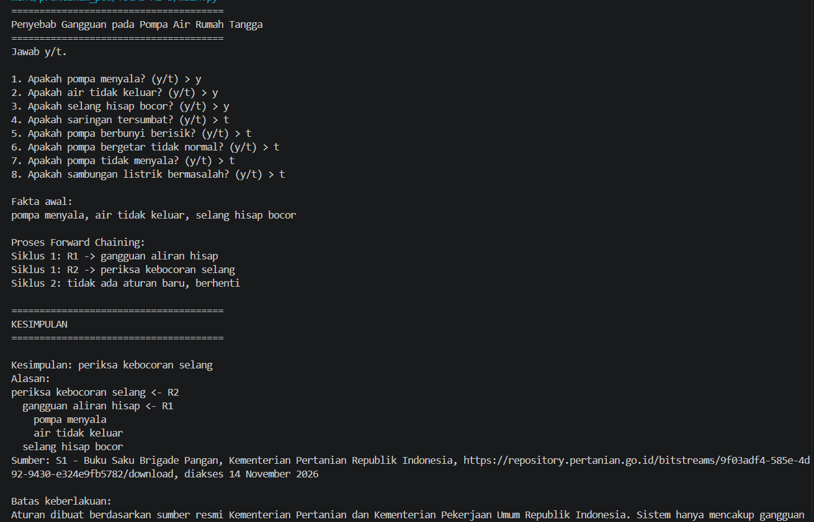
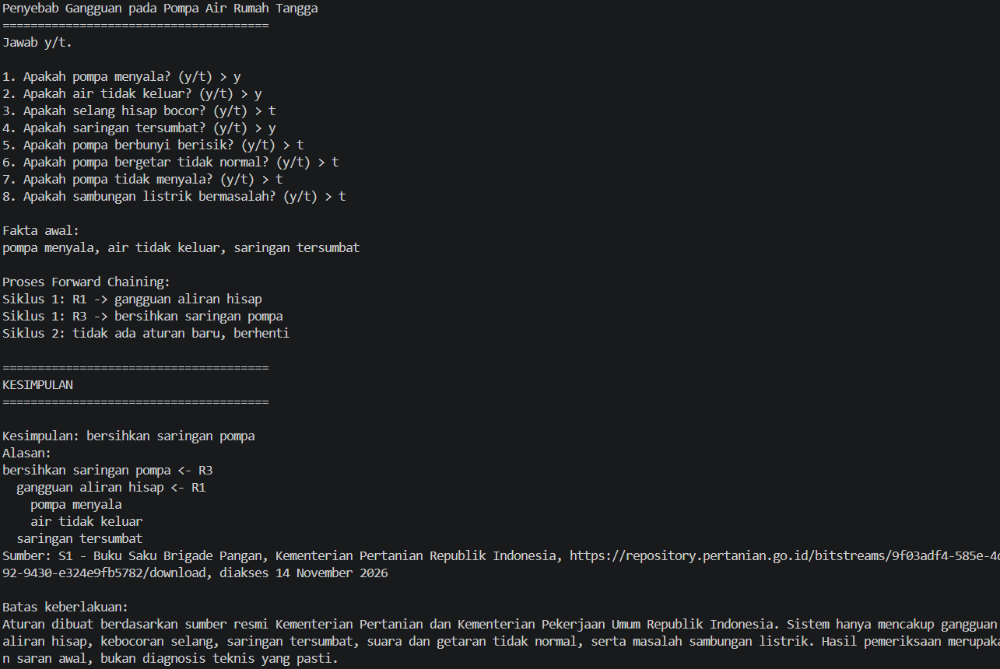
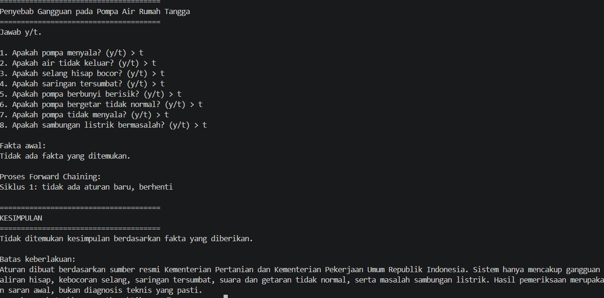

# Sistem Pakar Pemeriksaan Pompa Air

## Identitas
- Nama: Yoga Adiguna
- NIM: F1D02410028
- Mata Kuliah: Kecerdasan Buatan
- Materi: Materi 5 - Membuat Sistem Pakar Sederhana

## 1. Deskripsi
Sistem Pakar Pemeriksaan Pompa Air merupakan program
sederhana untuk membantu mengetahui kemungkinan
gangguan pada pompa air berdasarkan gejala yang
dimasukkan oleh pengguna.

Program dibuat menggunakan Python dengan basis
pengetahuan yang disimpan dalam file JSON.
Metode penalaran yang digunakan adalah Forward Chaining.

## 2. Teknologi
- Python
- JSON
- Forward Chaining

## 3. Cara Menjalankan
1. Pastikan Python sudah terpasang.
2. Buka folder proyek menggunakan VS Code.
3. Buka terminal.
4. Jalankan perintah:

```bash
python main.py
```

5. Jawab pertanyaan dengan:
   - y = Ya
   - t = Tidak

6. Program akan menampilkan kesimpulan
   berdasarkan gejala yang dimasukkan.

## 4. Basis Pengetahuan

Basis pengetahuan disimpan pada file `kb_pompa.json`.
Terdapat 5 aturan IF-THEN.

| ID | Kondisi | Kesimpulan |
|---|---|---|
| R1 | Pompa menyala DAN air tidak keluar | Gangguan aliran hisap |
| R2 | Gangguan aliran hisap DAN selang bocor | Periksa kebocoran selang |
| R3 | Gangguan aliran hisap DAN saringan tersumbat | Bersihkan saringan |
| R4 | Pompa berisik ATAU bergetar tidak normal | Hentikan pompa dan periksa komponennya |
| R5 | Pompa belum dipancing ATAU tabung pemancing kosong | Lakukan priming |

## 5. Metode Forward Chaining

Metode Forward Chaining digunakan untuk
menarik kesimpulan berdasarkan fakta awal
yang diberikan oleh pengguna.

Program mencocokkan fakta dengan aturan
IF-THEN yang terdapat pada file JSON.
Jika kondisi aturan terpenuhi, sistem akan
menghasilkan fakta baru atau kesimpulan.

Contohnya, ketika pompa menyala dan air tidak
keluar, aturan R1 menghasilkan fakta gangguan
aliran hisap. Fakta tersebut kemudian digunakan
oleh R2 atau R3 untuk menghasilkan kesimpulan.

## 6. Pengujian

### Pengujian 1 - Selang Hisap Bocor
Hasil: Periksa kebocoran selang hisap.
Aturan: R1 -> R2



### Pengujian 2 - Saringan Tersumbat
Hasil: Bersihkan saringan pompa.
Aturan: R1 -> R3



### Pengujian 3 - Tidak Ditemukan Gangguan
Hasil: Belum ditemukan kesimpulan berdasarkan gejala.



## 7. Batas Keberlakuan

Sistem ini menggunakan aturan dari sumber resmi
Kementerian Pertanian dan Kementerian Pekerjaan
Umum Republik Indonesia. Pemeriksaan hanya
mencakup gangguan aliran hisap, kebocoran selang,
saringan tersumbat, suara atau getaran tidak normal,
dan proses priming. Hasilnya merupakan saran awal,
bukan diagnosis teknis yang pasti.

## 8. Sumber Pengetahuan

1. Kementerian Pertanian Republik Indonesia.
   Pengoperasian Pompa Air: Identifikasi
   Permasalahan dan Cara Mengatasinya.
   https://repository.pertanian.go.id/bitstreams/9f03adf4-585e-4d92-9430-e324e9fb5782/download

2. Kementerian Pekerjaan Umum Republik Indonesia.
   Peraturan Menteri Pekerjaan Umum Nomor
   18/PRT/M/2007 tentang Penyelenggaraan
   Pengembangan Sistem Penyediaan Air Minum.
   https://jdih.pu.go.id/internal/assets/assets/produk/PermenPUPR/2007/06/permen18-2007.pdf

## 9. Penggunaan AI
Dalam pengerjaan tugas ini saya menggunakan AI seperti gemini sebagai alat bantu untuk memahami konsep Forward Chaining, membantu memahami alur kerja dan menyusun dokumentasi README.md.
